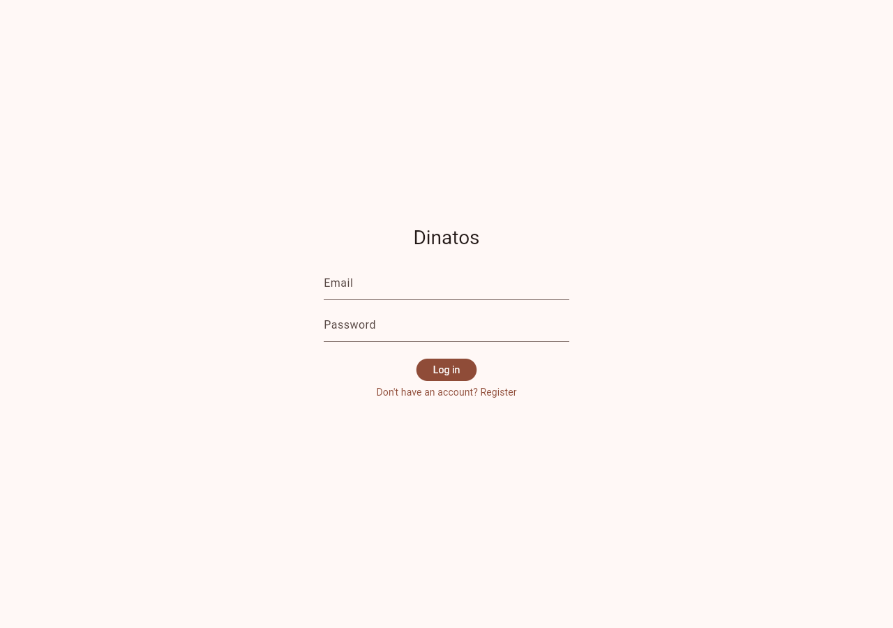
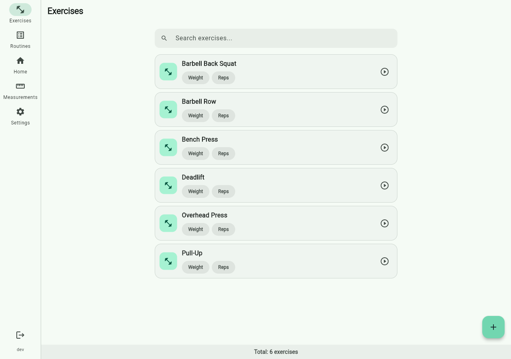
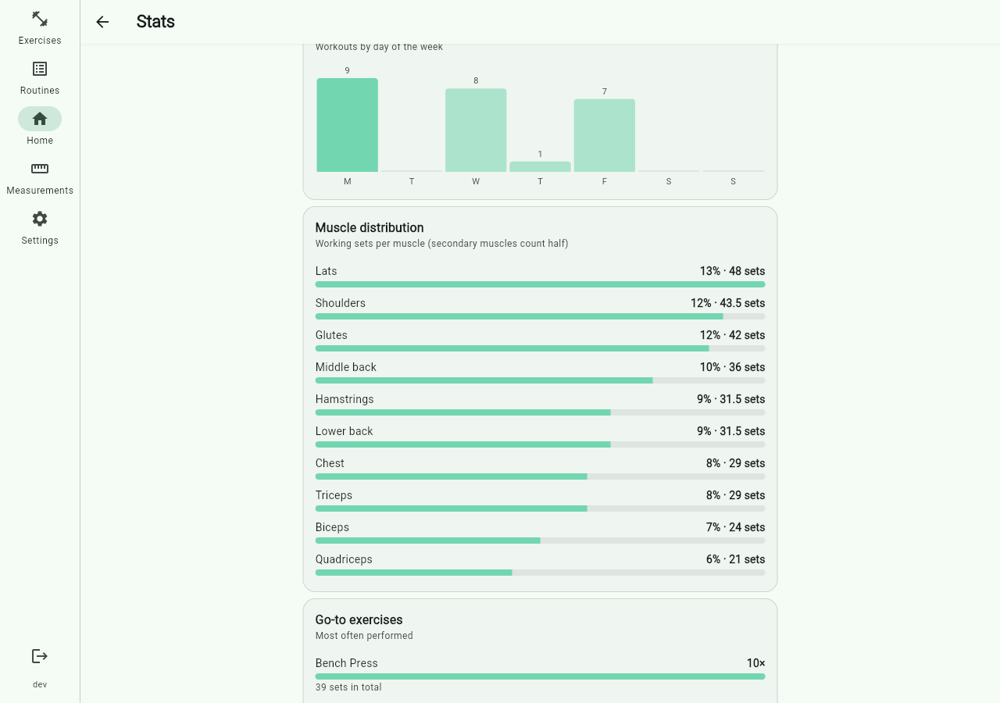
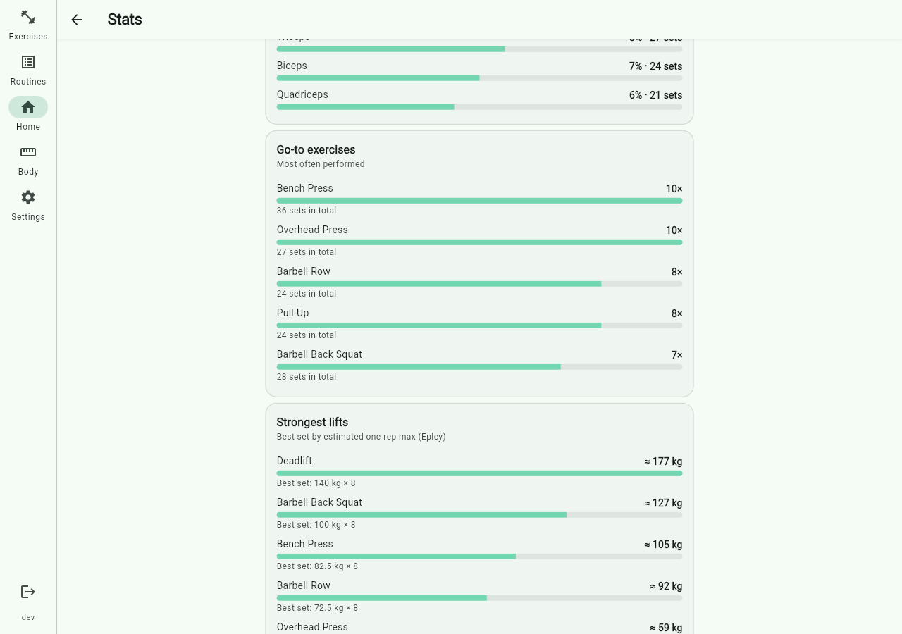

# Dinatos

A self-hosted workout tracker. Log exercises, build routines, record
workouts, and see your progress. Inspired by Hevy, built to run on your own
server.

- Log all your activities: cardio, strength and bodyweight exercises
- Save frequently used activities as routines and reuse.
- Select from a catalog exercises, or add your own.
- Track bodyweight measurements and personal records.
- Use from Web, Android and Linux desktop apps (garmin app coming soon)
- Import runs from [intervals.icu](https://intervals.icu/) and workouts from [Hevy](https://hevy.com).
- Connect with AI agent using embedded MCP server

## Screenshots

<!-- screenshots:start -- generated by screenshots/generate.py, do not edit by hand -->
<table>
<tr>
<td align="center" width="50%">
<br>
<sub>Signing in</sub>
</td>
<td align="center" width="50%">
<br>
<sub>The exercise catalog</sub>
</td>
</tr>
<tr>
<td align="center" width="50%">
<br>
<sub>Building a saved routine</sub>
</td>
<td align="center" width="50%">
<br>
<sub>Logging an activity from it</sub>
</td>
</tr>
<tr>
<td align="center" width="50%">
<br>
<sub>Home: the last 30 days at a glance</sub>
</td>
<td align="center" width="50%">
<br>
<sub>Stats: frequency, duration and volume</sub>
</td>
</tr>
<tr>
<td align="center" width="50%">
<br>
<sub>Stats: muscle split and go-to exercises</sub>
</td>
<td align="center" width="50%">
<br>
<sub>Stats: strongest lifts</sub>
</td>
</tr>
</table>
<!-- screenshots:end -->

## Run it

You need Docker.

```bash
cp .env.example .env      # set POSTGRES_PASSWORD; the file explains the rest
docker compose up -d      # Postgres + the app
```

Open <http://127.0.0.1:8000>. The web UI is served by the same container, so
there is nothing else to build.

More: [configuration, upgrades, backups and native clients](https://bergercookie.github.io/dinatos/deploy/index.html).

## Use it

[User guide](https://bergercookie.github.io/dinatos/user-guide/index.html):
logging workouts, measurements, importing history.

## Contribute

Contributions are welcome. Start with [CONTRIBUTING.md](https://github.com/bergercookie/dinatos/blob/main/CONTRIBUTING.md): it
gets you from clone to passing tests in a few commands.

Day-to-day workflow, CI and releases: the
[development guide](https://bergercookie.github.io/dinatos/development/index.html).
How it is built: [architecture docs](https://bergercookie.github.io/dinatos/architecture/index.html).

## Releases

Each release publishes a Docker image (`ghcr.io/bergercookie/dinatos`), a
Linux `.deb` and `.AppImage`, and an Android APK. See the
[releases page](https://github.com/bergercookie/dinatos/releases).

## Security

Report vulnerabilities privately: see [SECURITY.md](https://github.com/bergercookie/dinatos/blob/main/SECURITY.md).
