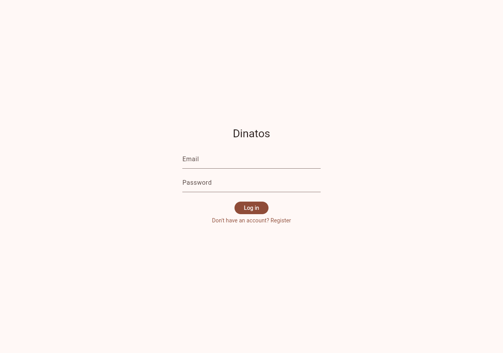
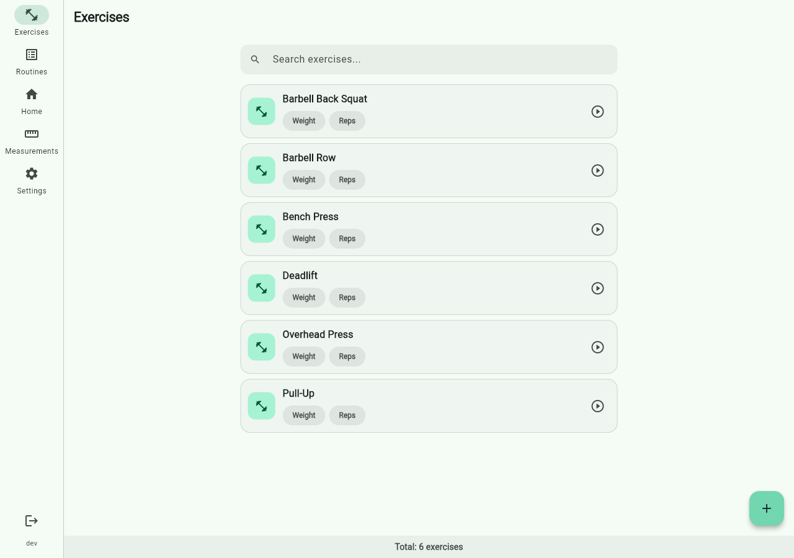
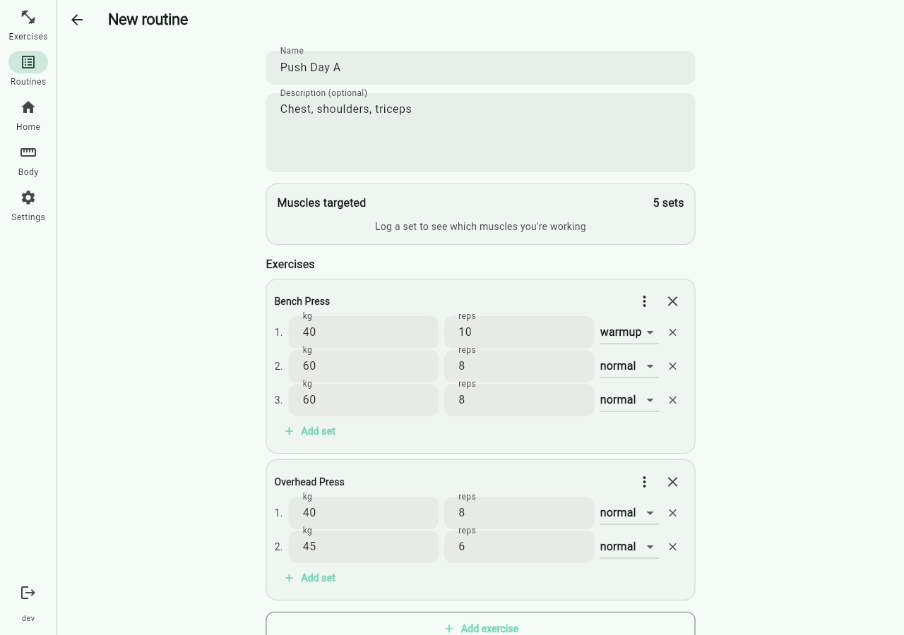
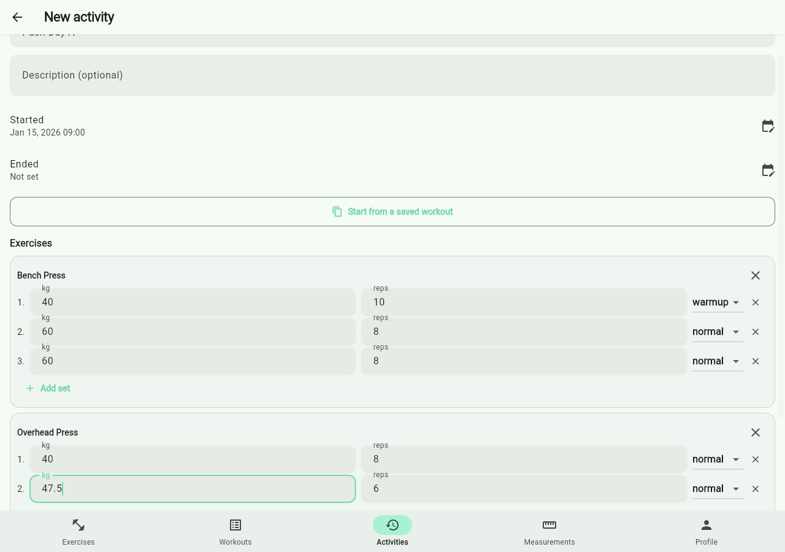
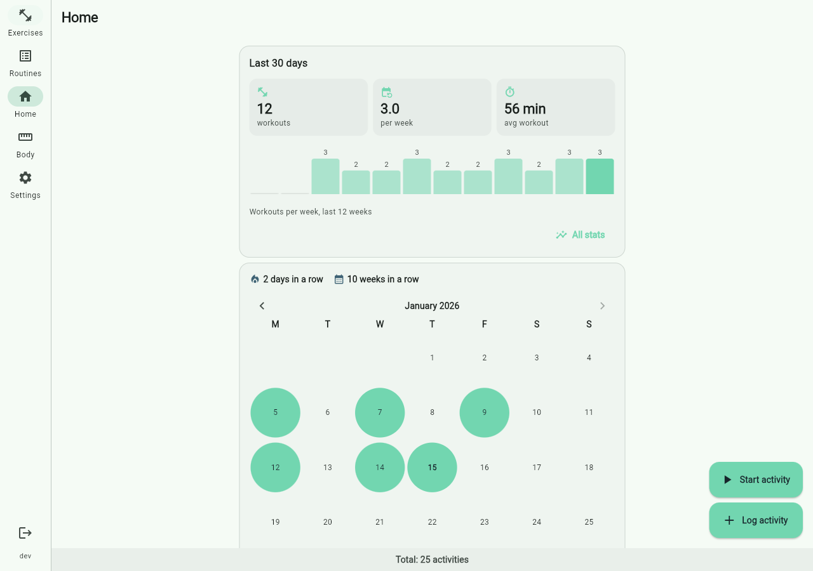
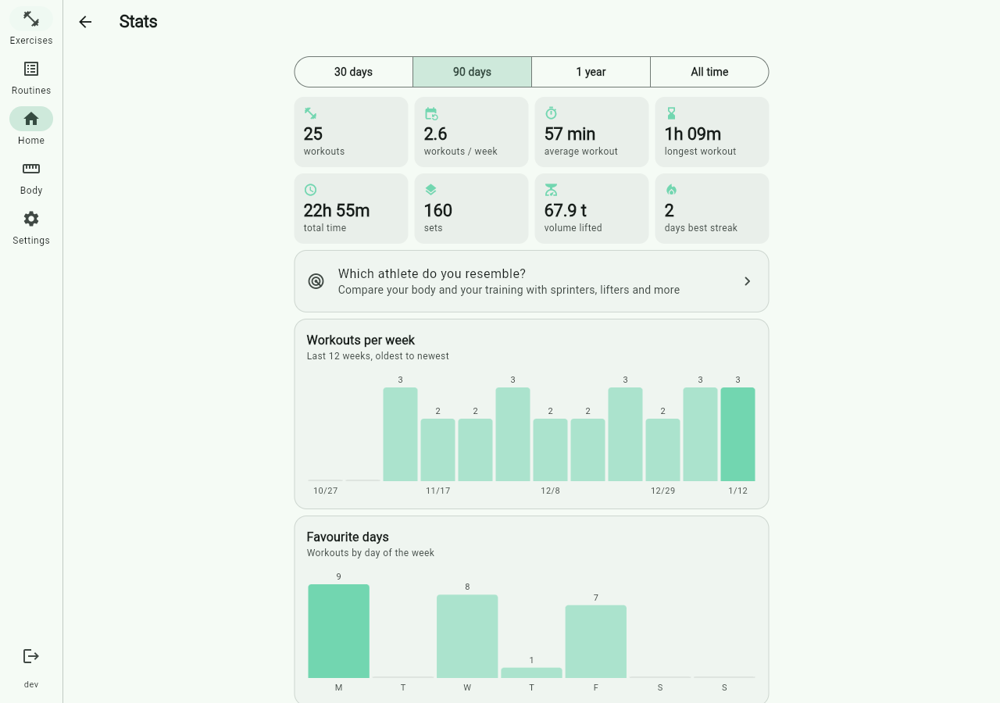
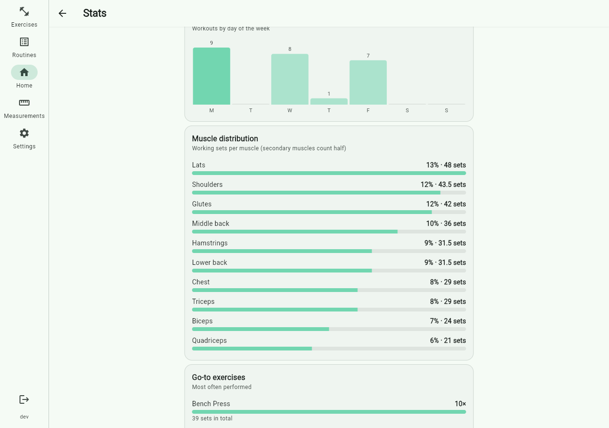
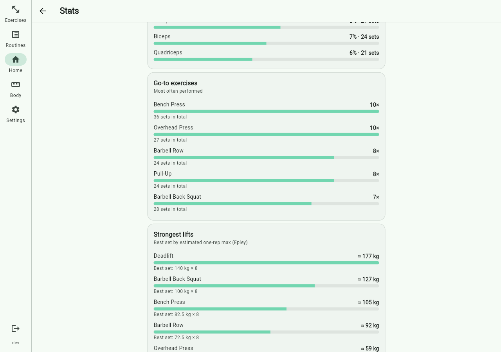

# Dinatos

A self-hosted workout tracker. Log exercises, build routines, record
workouts, and see your progress. Inspired by Hevy, built to run on your own
server.

- Multi-user accounts, exercises, routines, live workout logging
- Stats: frequency, time, muscle split, best lifts
- Import your history from Hevy (CSV) and Intervals.icu
- Web, Android and Linux desktop apps, one backend

## Screenshots

<!-- screenshots:start -- generated by screenshots/generate.py, do not edit by hand -->
<table>
<tr>
<td align="center" width="50%">
<br>
<sub>Signing in</sub>
</td>
<td align="center" width="50%">
<br>
<sub>The exercise catalog</sub>
</td>
</tr>
<tr>
<td align="center" width="50%">
<br>
<sub>Building a saved routine</sub>
</td>
<td align="center" width="50%">
<br>
<sub>Logging an activity from it</sub>
</td>
</tr>
<tr>
<td align="center" width="50%">
<br>
<sub>Home: the last 30 days at a glance</sub>
</td>
<td align="center" width="50%">
<br>
<sub>Stats: frequency, duration and volume</sub>
</td>
</tr>
<tr>
<td align="center" width="50%">
<br>
<sub>Stats: muscle split and go-to exercises</sub>
</td>
<td align="center" width="50%">
<br>
<sub>Stats: strongest lifts</sub>
</td>
</tr>
</table>
<!-- screenshots:end -->

## Run it

You need Docker.

```bash
cp .env.example .env      # set POSTGRES_PASSWORD; the file explains the rest
docker compose up -d      # Postgres + the app
```

Open <http://127.0.0.1:8000>. The web UI is served by the same container, so
there is nothing else to build.

More: [configuration, upgrades, backups and native clients](https://bergercookie.github.io/dinatos/deploy/index.html).

## Use it

[User guide](https://bergercookie.github.io/dinatos/user-guide/index.html):
logging workouts, measurements, importing history.

## Contribute

Contributions are welcome. Start with [CONTRIBUTING.md](CONTRIBUTING.md): it
gets you from clone to passing tests in a few commands.

How it is built: [architecture docs](https://bergercookie.github.io/dinatos/architecture/index.html).

## Releases

Each release publishes a Docker image (`ghcr.io/bergercookie/dinatos`), a
Linux `.deb` and `.AppImage`, and an Android APK. See the
[releases page](https://github.com/bergercookie/dinatos/releases). The native
apps ask for your server's URL on first launch.

## Security

Report vulnerabilities privately: see [SECURITY.md](SECURITY.md).

## License

[MIT](LICENSE)
