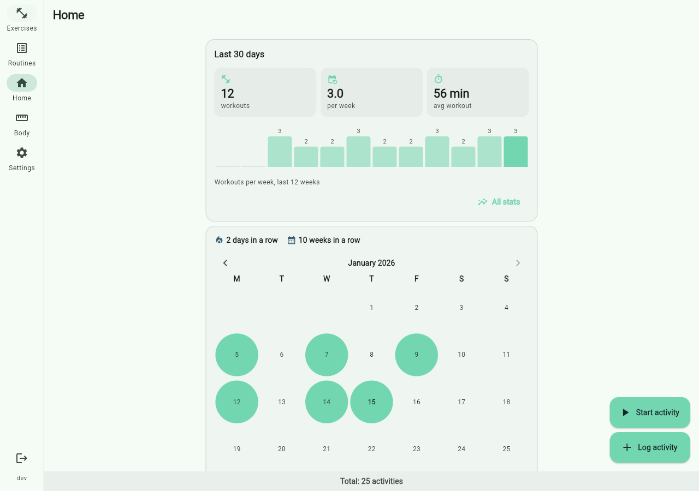
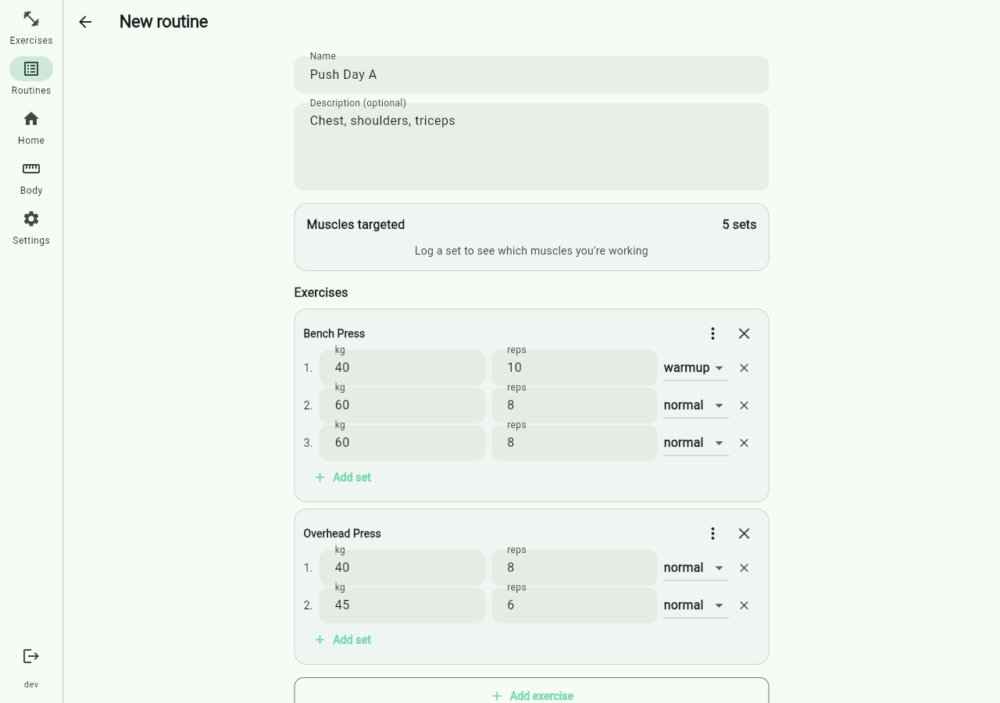
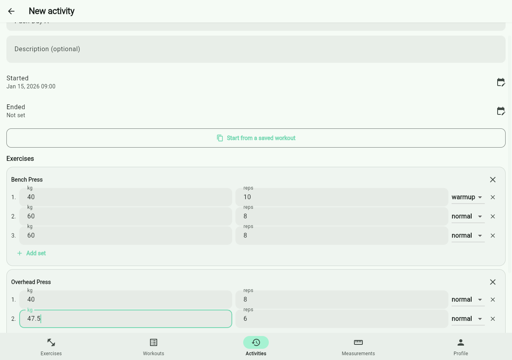
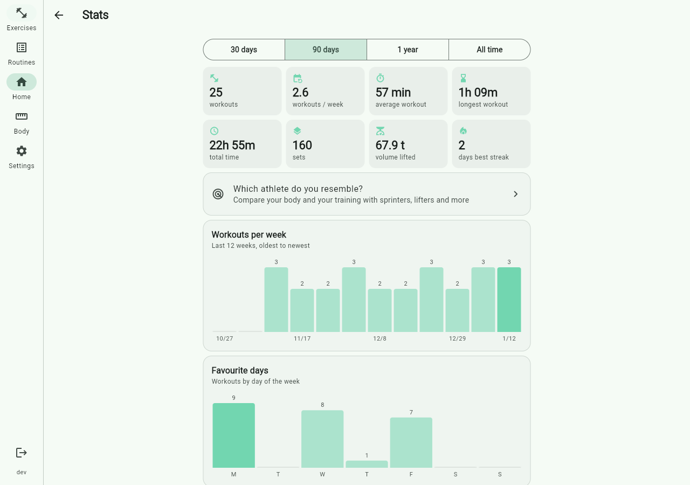

# Dinatos

Dinatos is a self-hosted workout tracker. You log exercises, build routines,
record workouts, and see your progress. Hevy inspired it. It runs on
your own server.

- Log all your activities: cardio, strength and bodyweight exercises.
- Save frequently used activities as routines, and use them again.
- Choose exercises from a catalog, or add your own.
- Track bodyweight measurements and personal records.
- Use the web app, the Android app or the Linux desktop app. The project plans a Garmin app.
- Import runs from [intervals.icu](https://intervals.icu/) and workouts from
  [Hevy](https://hevy.com).
- Connect an AI agent to the built-in MCP server.

## Screenshots

<!-- screenshots:start -- generated by screenshots/generate.py, do not edit by hand -->
<p align="center">
<br>
<sub>Home: the last 30 days at a glance</sub>
</p>
<p align="center">
<br>
<sub>Building a saved routine</sub>
</p>
<p align="center">
<br>
<sub>Logging an activity from it</sub>
</p>
<p align="center">
<br>
<sub>Stats: frequency, duration and volume</sub>
</p>
<!-- screenshots:end -->

## Run it

You need Docker.

```bash
cp .env.example .env      # set POSTGRES_PASSWORD; the file explains the rest
docker compose up -d      # Postgres + the app
```

Open <http://127.0.0.1:8000>. The same container serves the web UI, so you do
not need to build anything else.

For more, see [configuration, upgrades, backups and native clients](https://bergercookie.github.io/dinatos/deploy/index.html).

## Use it

The [user guide](https://bergercookie.github.io/dinatos/user-guide/index.html)
explains how to log workouts, add measurements and import your history.

## Contribute

We welcome contributions. Start with
[CONTRIBUTING.md](https://github.com/bergercookie/dinatos/blob/main/CONTRIBUTING.md).
It shows you how to go from a clone to passing tests in a few commands.

For the daily workflow, CI and releases, read the
[development guide](https://bergercookie.github.io/dinatos/development/index.html).
To learn how the code works, read the
[architecture docs](https://bergercookie.github.io/dinatos/architecture/index.html).

## Releases

Each release publishes a Docker image (`ghcr.io/bergercookie/dinatos`), a
Linux `.deb` package, a Linux `.AppImage` file and an Android APK. See the
[releases page](https://github.com/bergercookie/dinatos/releases).

## Security

To report a vulnerability, do not use a public issue. Read
[SECURITY.md](https://github.com/bergercookie/dinatos/blob/main/SECURITY.md).
